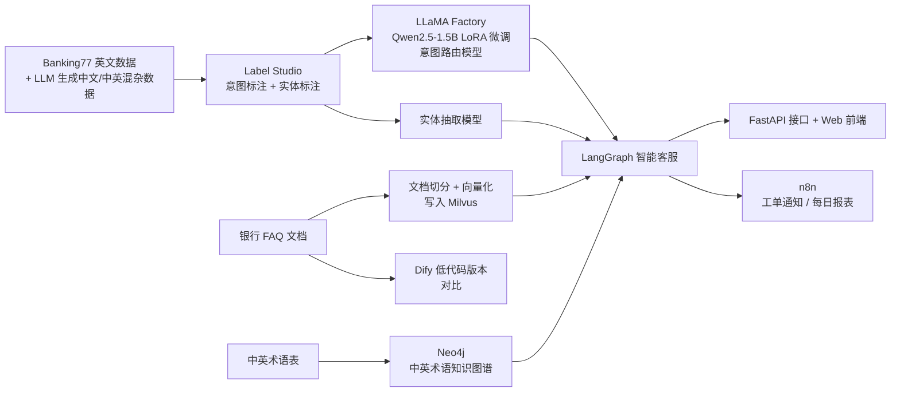
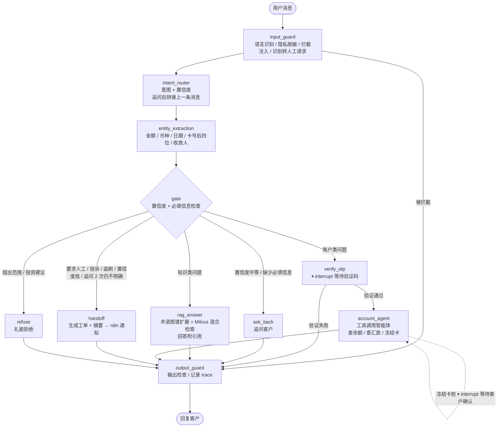

# 狮城银行中英双语智能客服系统

——基于 LLaMA Factory 微调、LangGraph 多节点编排与知识图谱的全流程实践

## 一、项目选题

- **领域**：金融（银行零售客服）
- **场景**：新加坡银行的线上智能客服。客户使用英文、中文以及中英混杂（code-switching）的方式咨询业务，
  例如："我想 check 一下我的 remittance 到了没有"。
- **目标用户**：银行零售客户（提问方）、人工客服坐席（处理转人工工单）
- **项目背景**：本人曾在新加坡某中资银行担任软件工程师约半年，了解银行系统在上线新技术时面临的
  数据安全、合规审查与系统可控性要求。本项目从工程落地的角度，设计一个"能够通过银行上线评审"的智能客服。
  （注：项目中的银行"狮城银行"及所有业务数据均为虚构。）
- **行业参考**：
  - 《客户世界》2026 年 10 月《商业银行客服中心智能语音导航系统满意度提升路径研究》（作者来自国有大行远程银行中心）指出：
    多数银行只支持中英文且无法识别混合语言指令；口语化表达（如"我的钱找不到了"）容易被误判为不同意图；
    转人工后客户需要重复说明问题（信息传递断层）。这些分别对应本项目的 P1、置信度分流与追问、转人工工单摘要。
  - 新晨科技"某国有大型银行智能客服系统"案例：采用知识库 + 知识图谱、意图识别、工单管理和合规质检（200+ 检查点），
    说明知识图谱与合规检查是银行客服的常见做法。本项目在此基础上引入本地微调大模型与 LangGraph 编排。

## 二、项目需求

### 2.1 项目痛点

银行智能客服落地面临多方面挑战：

| 编号  | 痛点          | 说明                                               |
| --- | ----------- | ------------------------------------------------ |
| P1  | 中英混杂输入难识别   | 新加坡客户常在一句话中混用中英文，传统关键词/规则机器人维护成本高、识别率低           |
| P2  | 客户数据不能出行    | 受监管与隐私保护要求（如 PDPA），客户数据不宜发送至外部大模型 API，需要可本地部署的模型 |
| P3  | 高风险操作需校验与确认 | 查询账户、冻结银行卡等操作必须先验证身份，并由客户确认后执行，不能由模型自行决定         |
| P4  | LLM 幻觉与合规要求 | 回答必须有官方依据、不能编造；不能提供投资建议；需防止隐私泄露与提示注入攻击           |
| P5  | 缺少审计与可追溯    | 每一步决策（意图、置信度、调用的工具与参数）需可记录、可回放                   |
| P6  | 与现有系统集成     | 需对接工单系统与通知渠道，而不是孤立的 Demo                         |
| P7  | 缺少运营复盘      | 无法了解客户问了哪些知识库未覆盖的问题                              |

**本期（一周）聚焦核心痛点：P1、P2、P3、P4。**
P5、P6 部分覆盖（执行路径日志、n8n 工单通知），P7 列入后续规划。

### 2.2 业务需求（功能清单）

| 编号  | 功能                                               | 解决痛点  | 优先级  |
| --- | ------------------------------------------------ | ----- | ---- |
| F1  | 中英双语意图识别（先用提示词，后替换为本地微调小模型，输出置信度）                | P1、P2 | MVP  |
| F2  | 知识库问答（RAG，Milvus 稠密向量 + BM25 混合检索），回答附引用来源       | P4    | MVP  |
| F3  | 账户查询：余额、汇款进度（OTP 身份验证后才可查询）                      | P3    | MVP  |
| F4  | 安全护栏：卡号/身份证号脱敏、拒绝投资建议、防提示注入；欢迎语明确告知"您正在与 AI 客服对话" | P4    | MVP  |
| F5  | 转人工：生成工单并附摘要（一级/二级意图、已抽取信息、是否已验证身份），坐席无需让客户重复说明；盗刷等紧急情况优先处理 | P3、P6 | MVP  |
| F6  | 执行路径记录（每轮对话的意图、置信度、节点路径、工具调用）                    | P5    | MVP  |
| F7  | 使用 LLaMA Factory 微调 Qwen2.5-1.5B（LoRA）作为本地意图路由模型，输出两级意图（一级/二级） | P1、P2 | 本周   |
| F8  | 实体抽取：金额、币种、日期、卡号后四位、收款人                          | P1    | 本周   |
| F9  | 信息缺失时自动追问（如：您指的是哪一笔转账？）；连续追问 2 次仍无法确定时自动转人工      | P3    | 本周   |
| F10 | 冻结银行卡：执行前需客户确认（人机协同）                             | P3    | 本周   |
| F11 | 置信度分流：高→自动回答，中→向客户确认，低→转人工；客户明确要求人工时直接转人工（独立于意图） | P3、P4 | 本周   |
| F12 | 中英术语知识图谱（Neo4j）：将客户用语映射为银行术语，用于检索扩展              | P1    | 本周   |
| F13 | n8n 自动化：工单通知、每日数据报表（自助解决率、转人工比例、平均追问次数）       | P6    | 本周   |
| F14 | Dify 低代码版本（与代码版本对比）                              | —     | 加分项  |
| F15 | 知识缺口周报、完整审计系统、人工坐席工作台优化                          | P5、P7 | 后续规划 |

**设计原则**：主流程采用固定工作流（LangGraph）保证合规可控；仅在账户查询环节使用工具调用智能体，
由智能体决定"查什么"，但身份验证、客户 ID、操作确认均在智能体之外由系统控制。

### 2.3 MVP

**目标**：先跑通一条完整链路，再逐步替换与升级。

**MVP 范围**：F1–F6

- 意图识别：先用大模型提示词分类，跑通流程
- 三类核心业务：FAQ 问答、汇款进度查询（含 OTP）、转人工
- 安全护栏与执行路径记录
- 简单 Web 界面

**MVP 验收标准**：

1. 中文、英文、中英混杂各至少 2 段测试对话，全部进入正确分支
2. FAQ 回答均附带引用来源
3. 未通过 OTP 验证时无法获取任何账户信息
4. 投资建议类问题被拒绝，卡号在记录中被脱敏

**MVP 之后的迭代顺序**：
F7 本地微调模型 → F8/F9 实体抽取与追问 → F10/F11 卡冻结确认与置信度分流 → F12 知识图谱 → F13 n8n → F14 Dify

## 三、整体流程图

### 3.1 离线构建流程（数据 → 模型 → 应用）

### 3.2 在线对话流程（LangGraph 主图）

**说明**：
- **固定流程 + 局部智能体**：除 `account_agent` 外，所有节点和分支由代码决定；智能体只决定"查什么"，
  身份验证（`verify_otp`）和操作确认（冻结卡前的 `interrupt`）都在智能体之外由系统控制。
- **多轮对话**：`ask_back` 追问后本轮结束；客户补充信息后，新消息重新进入主图，
  上一轮的意图和已抽取的实体通过 checkpointer（以 `session_id` 为 thread_id）保留。
- **人机协同**：`interrupt` 暂停流程等待客户输入（验证码 / 确认），客户回复后从暂停处继续执行。

## 四、GraphState 设计

主图各节点之间通过 `GraphState`（`TypedDict`）传递数据。

| 分组 | 字段 | 类型 | 写入节点 | 跨轮保留 | 说明 |
|---|---|---|---|---|---|
| 输入 | `session_id` | `str` | 系统 | 是 | 会话 ID，同时作为 checkpointer 的 thread_id |
| 输入 | `customer_id` | `str` | 系统 | 是 | 登录客户 ID，**由系统注入，模型不可生成或修改** |
| 输入 | `question` | `str` | 系统 | 否 | 本轮原始问题 |
| 输入 | `messages` | `list[BaseMessage]` | 各节点 | 是 | 对话历史，使用 `add_messages` 合并 |
| 护栏 | `lang` | `"en" \| "zh" \| "mixed"` | input_guard | 否 | 识别语言，决定回复语言 |
| 护栏 | `masked_question` | `str` | input_guard | 否 | 脱敏后的问题，后续节点只使用该字段 |
| 护栏 | `blocked` | `bool` | input_guard | 否 | 是否被拦截（注入攻击等） |
| 护栏 | `human_requested` | `bool` | input_guard | 否 | 客户是否明确要求转人工；独立于意图（"卡丢了，转人工"仍识别为挂失意图） |
| 意图 | `intent` | `str` | intent_router | 是 | 一级意图，决定分支（追问后需要沿用） |
| 意图 | `sub_intent` | `str` | intent_router | 否 | 二级意图，用于 RAG 检索过滤、看板与评估，不参与分流 |
| 意图 | `intent_score` | `float` | intent_router | 否 | 一级意图置信度 0~1 |
| 意图 | `router_backend` | `str` | intent_router | 否 | 使用的路由模型：finetuned / llm / keyword |
| 实体 | `entities` | `dict[str, str]` | entity_extraction | 是 | 已抽取的实体，追问后与新实体合并 |
| 实体 | `missing_slots` | `list[str]` | gate | 否 | 当前意图缺少的必填信息 |
| 分流 | `clarify_count` | `int` | gate | 是 | 连续追问次数，达到 2 次转人工；进入其他分支后清零；大于 0 时意图路由拼接上一条消息 |
| 分流 | `decision` | `"answer" \| "clarify" \| "handoff" \| "refuse"` | gate | 否 | 置信度分流结果 |
| 分流 | `route` | `str` | gate | 否 | 实际进入的分支：rag / account / handoff / refuse / ask_back |
| 检索 | `search_query` | `str` | rag_answer | 否 | 术语扩展后的检索语句 |
| 检索 | `sources` | `list[dict]` | rag_answer | 否 | 引用来源（文档、章节、片段） |
| 账户 | `otp_verified` | `bool` | verify_otp | 是 | 本会话是否已通过验证，避免重复验证 |
| 账户 | `tool_calls` | `list[dict]` | account_agent | 否 | 工具名、参数、结果（审计用） |
| 工单 | `ticket_id` | `int \| None` | handoff | 是 | 工单号 |
| 工单 | `priority` | `"normal" \| "urgent"` | handoff | 否 | 盗刷等为 urgent |
| 输出 | `answer` | `str` | 各分支 / output_guard | 否 | 最终回复 |
| 输出 | `trace` | `list[str]` | 每个节点 | 否 | 执行路径（节点名列表），用于审计与前端展示 |
| 输出 | `error` | `str \| None` | BaseNode | 否 | 节点异常信息 |

**设计要点**：
1. **每轮重置 vs 跨轮保留**：每轮开始时重置"否"的字段（如 `trace`、`sources`、`tool_calls`），
   避免上一轮的结果混入本轮；"是"的字段支撑多轮追问和免重复验证。
2. **安全字段只由系统写入**：`customer_id`、`otp_verified` 不允许由 LLM 输出决定。
3. **只传脱敏后的文本**：`masked_question` 之后的节点（包括调用 LLM 的节点）不接触原始卡号/身份证号。
4. **trace 即审计日志**：结合 `intent_score`、`tool_calls`，每轮对话的决策过程都可回放。

## 五、技术栈

Python 3.12（uv 管理）· LangGraph / LangChain · LLaMA Factory（Qwen2.5-1.5B LoRA）· Label Studio ·
Milvus 混合检索（稠密向量 + BM25）· Neo4j · MySQL 8（模拟银行业务库）· FastAPI · Streamlit · n8n · Dify

## 六、评估方式

- 意图识别：准确率、宏平均 F1，按中文 / 英文 / 中英混杂分别统计；对比"基座模型 / API 大模型 / 微调模型"
- 一级、二级意图准确率分开统计：一级高、二级低说明错误多在同一分支内（影响小）；两者接近说明错误都会进错分支（影响大）
- 知识库问答：检索命中率、回答引用正确率
- 安全护栏：拦截率与误拦率
- 业务指标（参考行业文章，由 `turn_log` 统计）：自助解决率（未转人工的会话占比）、转人工比例、平均追问次数
- 以上指标均来自离线测试集或演示对话，不代表真实线上数据
