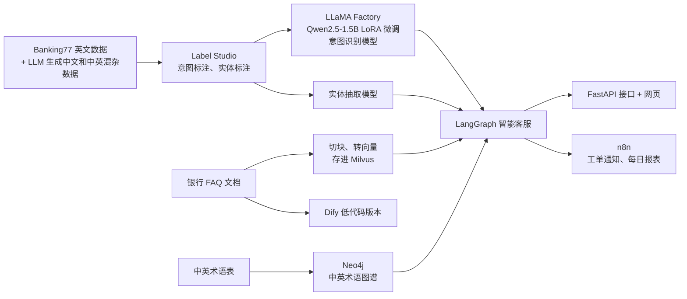
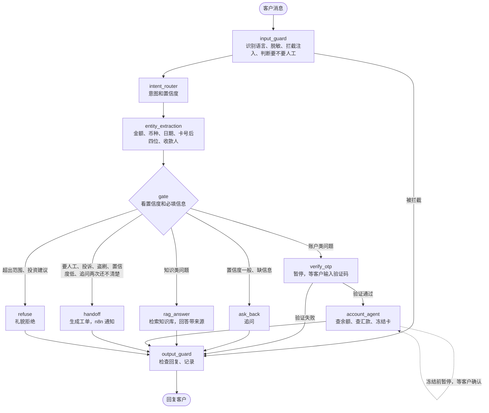

# 狮城银行中英双语智能客服系统

基于 LLaMA Factory 微调、LangGraph 多节点编排与知识图谱的全流程实践

## 一、项目选题

- 领域：金融，银行的零售客服
- 场景：新加坡银行的线上智能客服。新加坡的客户问问题时，有的用英文，有的用中文，很多人会中英文混着说，
  比如"我想 check 一下我的 remittance 到了没有"。
- 用户：银行的零售客户，还有处理转人工工单的人工客服
- 背景：我之前在新加坡一家中资银行做了大概半年的软件工程师，知道银行上线新系统时对数据安全、合规审查要求很严。
  所以这个项目想从实际落地的角度出发，做一个银行有可能真的会用的智能客服。
  项目里的"狮城银行"和所有业务数据都是虚构的。
- 参考资料：
  - 《客户世界》2026 年 10 月的文章《商业银行客服中心智能语音导航系统满意度提升路径研究》提到，
    很多银行只支持中文和英文，客户中英混着说就识别不了；"我的钱找不到了"这种口语容易被分错；
    转到人工以后，客户还要把问题重新说一遍。这几个问题本项目都有考虑。
  - 新晨科技做的一个国有大型银行智能客服案例，用了知识库、知识图谱、意图识别、工单管理和合规质检，
    说明这些在银行客服里都是常见的做法。本项目在这个基础上加了本地微调的大模型和 LangGraph。

## 二、项目需求

### 2.1 痛点

| 编号 | 痛点 | 说明 |
| --- | --- | --- |
| P1 | 中英混杂的问题识别不准 | 新加坡客户经常一句话里中英文混着说，用关键词规则做的机器人很难维护，识别率也低 |
| P2 | 客户数据不能外传 | 监管和隐私保护（比如 PDPA）要求客户数据不能随便发给外部的大模型 API，需要能在本地部署的模型 |
| P3 | 高风险操作要验证和确认 | 查账户、冻结银行卡之前必须先验证身份，冻结还要客户确认，不能让模型自己决定 |
| P4 | 大模型会乱编、合规要求高 | 回答要有依据，不能编；不能给投资建议；还要防止泄露隐私和提示注入 |
| P5 | 很难审计 | 每一步怎么判断的（意图、置信度、调了什么工具）都要能记录和回看 |
| P6 | 要和现有系统打通 | 要能接工单系统和通知，不能只是一个单独的 Demo |
| P7 | 不知道客户问了什么没答上 | 不清楚哪些问题知识库里没有 |

这次只有一周，主要解决 P1 到 P4。P5、P6 做一部分（记录执行路径、n8n 发工单通知），P7 放到以后。

### 2.2 功能

| 编号 | 功能 | 对应痛点 | 优先级 |
| --- | --- | --- | --- |
| F1 | 中英双语意图识别，输出置信度。先用提示词，后面换成本地微调的小模型 | P1、P2 | MVP |
| F2 | 知识库问答：本地 BGE-M3 生成稠密和稀疏两种向量，在 Milvus 里混合检索，回答带上来源。回答用 DeepSeek 生成，只发脱敏后的问题和公开的 FAQ，也可以换成本地的 Qwen | P2、P4 | MVP |
| F3 | 查余额、查汇款进度，要先通过 OTP 验证 | P3 | MVP |
| F4 | 安全检查：卡号和身份证号脱敏，不给投资建议，防提示注入；欢迎语里说明是 AI 客服 | P4 | MVP |
| F5 | 转人工：生成工单，带上意图、已经知道的信息、有没有验证过身份，人工客服不用让客户再说一遍；盗刷这类紧急的优先处理 | P3、P6 | MVP |
| F6 | 记录每一轮的意图、置信度、经过的节点和调用的工具 | P5 | MVP |
| F7 | 用 LLaMA Factory 对 Qwen2.5-1.5B 做 LoRA 微调，作为本地的意图识别模型，输出一级和二级意图 | P1、P2 | 本周 |
| F8 | 实体抽取：金额、币种、日期、卡号后四位、收款人 | P1 | 本周 |
| F9 | 信息不够时追问（比如"您指的是哪一笔转账？"），连续追问两次还不清楚就转人工 | P3 | 本周 |
| F10 | 冻结银行卡之前让客户确认 | P3 | 本周 |
| F11 | 按置信度分流：高的直接回答，中等的追问，低的转人工；客户说要人工就直接转人工 | P3、P4 | 本周 |
| F12 | 用 Neo4j 做中英术语图谱，把客户的说法对应到银行的术语，帮助检索 | P1 | 本周 |
| F13 | n8n：工单通知、每天的数据报表（自助解决率、转人工比例、平均追问次数） | P6 | 本周 |
| F14 | 用 Dify 做一个低代码的版本，和代码版本对比 | 无 | 加分项 |
| F15 | 知识缺口周报、完整的审计系统、人工客服工作台 | P5、P7 | 以后再做 |

整体上，主流程用 LangGraph 写成固定的工作流，这样比较可控。只有查账户这一步用了智能体，让它决定查什么，
但是身份验证、客户 ID、冻结前的确认都是系统控制的，不交给智能体。

### 2.3 MVP

先把整个流程跑通，再一步步替换和升级。MVP 包括 F1 到 F6：

- 意图识别先用大模型的提示词来分类
- 三种主要业务：FAQ 问答、查汇款进度（要 OTP）、转人工
- 安全检查和执行路径记录
- 一个简单的网页界面

MVP 做到这些就算完成：

1. 中文、英文、中英混杂各至少两段测试对话，都能进到正确的分支
2. FAQ 的回答都带来源
3. 没通过 OTP 验证就查不到任何账户信息
4. 问投资建议会被拒绝，记录里的卡号是脱敏的

MVP 之后的顺序：F7 微调模型，F8、F9 实体抽取和追问，F10、F11 冻结确认和置信度分流，F12 知识图谱，F13 n8n，F14 Dify。

## 三、整体流程

### 3.1 离线部分（数据、模型、知识库）

### 3.2 在线对话（LangGraph 主图）

几点说明：

- 除了 account_agent，其他节点和分支都是代码里写死的。智能体只决定查什么，验证身份和冻结前的确认都在它外面。
- 追问以后这一轮就结束了。客户补充信息时，新消息会重新走一遍主图，上一轮的意图和实体用 checkpointer 保存着
  （以 session_id 作为 thread_id）。
- 用 interrupt 暂停流程，等客户输入验证码或者确认，客户回复以后从暂停的地方继续。

## 四、GraphState

主图里的节点通过 GraphState（TypedDict）传数据。

| 分组 | 字段 | 类型 | 谁写入 | 跨轮保留 | 说明 |
|---|---|---|---|---|---|
| 输入 | session_id | str | 系统 | 是 | 会话 ID，也是 checkpointer 的 thread_id |
| 输入 | customer_id | str | 系统 | 是 | 登录的客户 ID，系统传进来，模型不能改 |
| 输入 | question | str | 系统 | 否 | 这一轮的原始问题 |
| 输入 | messages | list[BaseMessage] | 各节点 | 是 | 对话历史，用 add_messages 追加 |
| 安全 | lang | "en" / "zh" / "mixed" | input_guard | 否 | 客户用的语言，决定用什么语言回复 |
| 安全 | masked_question | str | input_guard | 否 | 脱敏后的问题，后面的节点都用它 |
| 安全 | blocked | bool | input_guard | 否 | 是否被拦截，比如提示注入 |
| 安全 | human_requested | bool | input_guard | 否 | 客户有没有说要人工。和意图分开，"卡丢了，转人工"的意图还是挂失 |
| 意图 | intent | str | intent_router | 是 | 一级意图，决定走哪个分支，追问以后还要用 |
| 意图 | sub_intent | str | intent_router | 否 | 二级意图，用在检索、统计和评估，不影响分流 |
| 意图 | intent_score | float | intent_router | 否 | 一级意图的置信度 |
| 意图 | router_backend | str | intent_router | 否 | 是模型判断的还是规则判断的 |
| 实体 | entities | dict[str, str] | entity_extraction | 是 | 抽到的实体，追问后和新的合并 |
| 实体 | missing_slots | list[str] | gate | 否 | 还缺哪些必填信息 |
| 分流 | clarify_count | int | gate | 是 | 连续追问了几次，到 2 次就转人工 |
| 分流 | decision | "answer" / "clarify" / "handoff" / "refuse" | gate | 否 | 分流结果 |
| 分流 | route | str | gate | 否 | 走哪个分支 |
| 检索 | search_query | str | rag_answer | 否 | 重写以后用来检索的问题 |
| 检索 | sources | list[dict] | rag_answer | 否 | 回答引用的来源 |
| 账户 | otp_verified | bool | verify_otp | 是 | 这个会话有没有验证过，验证过就不用再验 |
| 账户 | tool_calls | list[dict] | account_agent | 否 | 调用了哪些工具、参数和结果 |
| 工单 | ticket_id | int / None | handoff | 是 | 工单号 |
| 工单 | priority | "normal" / "urgent" | handoff | 否 | 盗刷是 urgent |
| 输出 | answer | str | 各个分支、output_guard | 否 | 最后的回复 |
| 输出 | trace | list[str] | 每个节点 | 否 | 经过了哪些节点 |
| 输出 | error | str / None | BaseNode | 否 | 节点出错的信息 |

设计时考虑的几点：

1. 跨轮保留为"否"的字段每轮开始都会重置，免得上一轮的 trace、sources 混进来；保留为"是"的字段用来支持追问和不用重复验证。
2. customer_id 和 otp_verified 只能由系统写，不能由大模型的输出决定。
3. 从 masked_question 开始，后面的节点（包括调大模型的）都看不到原始的卡号和身份证号。
4. trace 加上 intent_score 和 tool_calls，每一轮是怎么判断的都能回看。

## 五、技术栈

Python 3.12（用 uv 管理）、LangGraph / LangChain、LLaMA Factory（Qwen2.5-1.5B LoRA）、Label Studio、
BGE-M3（本地的稠密和稀疏向量）、Milvus（混合检索，RRF 合并）、DeepSeek（生成知识库回答）、Neo4j、
MySQL 8（模拟的银行数据库）、FastAPI、Streamlit、n8n、Dify

## 六、评估

- 意图识别：准确率和宏平均 F1，中文、英文、中英混杂分开算；对比没微调的基座模型、大模型 API 和微调后的模型
- 一级意图和二级意图的准确率分开算。一级高、二级低，说明分错的大多还在同一个分支里，影响不大；两个差不多，说明分错的都会走错分支
- 知识库问答：检索命中率、回答引用的来源对不对
- 安全检查：拦截率和误拦率
- 业务指标（从 turn_log 统计）：自助解决率（没转人工的会话占多少）、转人工比例、平均追问次数
- 上面这些都是用离线测试集或者演示对话算出来的，不代表真实上线后的数据
